# Database Design and Schema

This document outlines the database schema, table columns, and relationships for the application. The system is designed on PostgreSQL, utilizing UUIDs for primary keys, foreign keys for relationships, and soft-delete/audit columns on all tables.

## Entity Relationship Diagram

Below is the Mermaid ER diagram representing the relationships between the database tables:

```mermaid
erDiagram
    users {
        uuid id PK "Primary Key (gen_random_uuid())"
        boolean is_active "Active status flag"
        boolean is_deleted "Soft-delete flag"
        timestamptz created_at "Creation timestamp"
        timestamptz updated_at "Last update timestamp"
        varchar created_by "Username of creator"
        varchar updated_by "Username of modifier"
        int version "Optimistic-locking version"
        text email "Unique email address"
        text username "Unique username"
        text password "Hashed password"
        varchar role "RBAC role (user, admin)"
        int token_version "Bumped to revoke all access tokens"
        timestamptz email_verified_at "Email verification time (nullable)"
        int failed_login_attempts "Consecutive failed logins"
        timestamptz locked_until "Login lockout expiry (nullable)"
        text mfa_secret_encrypted "Encrypted TOTP seed (nullable)"
        timestamptz mfa_enabled_at "MFA activation time (nullable)"
    }

    todos {
        uuid id PK "Primary Key (gen_random_uuid())"
        boolean is_active "Active status flag"
        boolean is_deleted "Soft-delete flag"
        timestamptz created_at "Creation timestamp"
        timestamptz updated_at "Last update timestamp"
        varchar created_by "Username of creator"
        varchar updated_by "Username of modifier"
        int version "Optimistic-locking version"
        uuid user_id FK "Foreign Key to users.id"
        text title "Todo task title"
        text description "Detailed description"
        boolean is_completed "Completion status flag"
    }

    refresh_tokens {
        uuid id PK "Primary Key (gen_random_uuid())"
        boolean is_active "Active status flag"
        boolean is_deleted "Soft-delete flag"
        timestamptz created_at "Creation timestamp"
        timestamptz updated_at "Last update timestamp"
        varchar created_by "Username of creator"
        varchar updated_by "Username of modifier"
        int version "Optimistic-locking version"
        uuid user_id FK "Foreign Key to users.id"
        varchar token_hash "SHA-256 of the refresh token (unique)"
        uuid family_id "Shared by all rotations of one sign-in"
        timestamptz expires_at "Expiry"
        timestamptz revoked_at "Revocation/rotation time (nullable)"
        uuid replaced_by_id "Successor token id (nullable)"
        text user_agent "Client user agent (nullable)"
        varchar ip_address "Client IP (nullable)"
    }

    one_time_tokens {
        uuid id PK "Primary Key (gen_random_uuid())"
        boolean is_active "Active status flag"
        boolean is_deleted "Soft-delete flag"
        timestamptz created_at "Creation timestamp"
        timestamptz updated_at "Last update timestamp"
        varchar created_by "Username of creator"
        varchar updated_by "Username of modifier"
        int version "Optimistic-locking version"
        uuid user_id FK "Foreign Key to users.id"
        varchar purpose "verify_email or reset_password"
        varchar token_hash "SHA-256 of the token (unique)"
        timestamptz expires_at "Expiry"
        timestamptz used_at "Consumption time (nullable)"
    }

    outbox_events {
        uuid id PK "Primary Key (gen_random_uuid())"
        boolean is_active "Active status flag"
        boolean is_deleted "Soft-delete flag"
        timestamptz created_at "Creation timestamp"
        timestamptz updated_at "Last update timestamp"
        varchar created_by "Username of creator"
        varchar updated_by "Username of modifier"
        int version "Optimistic-locking version"
        varchar event_type "Handler key, e.g. email.send"
        jsonb payload "Event data"
        varchar status "pending, done or dead"
        int attempts "Delivery attempts so far"
        timestamptz available_at "Next delivery time (backoff)"
        timestamptz processed_at "Delivery time (nullable)"
        text last_error "Last failure (nullable)"
    }

    audit_logs {
        uuid id PK "Primary Key (gen_random_uuid())"
        boolean is_active "Active status flag"
        boolean is_deleted "Soft-delete flag"
        timestamptz created_at "Creation timestamp"
        timestamptz updated_at "Last update timestamp"
        varchar created_by "Username of creator"
        varchar updated_by "Username of modifier"
        int version "Optimistic-locking version"
        uuid actor_id "Acting user (no FK: survives account deletion)"
        varchar action "e.g. auth.signin.failed"
        varchar resource_type "Affected resource type (nullable)"
        varchar resource_id "Affected resource id (nullable)"
        varchar outcome "success or failure"
        varchar ip_address "Client IP (nullable)"
        text user_agent "Client user agent (nullable)"
        varchar request_id "Correlation id (nullable)"
        jsonb details "Extra context, never secrets"
    }

    idempotency_keys {
        uuid id PK "Primary Key (gen_random_uuid())"
        varchar scope "user:<id> or ip:<address>"
        varchar key "Client Idempotency-Key"
        varchar request_hash "SHA-256 of method, path and body"
        varchar status "in_progress or completed"
        int response_status "Stored status code (nullable)"
        jsonb response_headers "Stored headers (nullable)"
        bytea response_body "Stored body (nullable)"
        timestamptz expires_at "Expiry (IDEMPOTENCY_TTL_HOURS)"
    }

    users ||--o{ todos : "has/owns"
    users ||--o{ refresh_tokens : "sessions"
    users ||--o{ one_time_tokens : "verification/reset links"
```

---

## Tables and Columns Detail

### 1. Common Audit Columns (`BaseModel`)

All tables inherit from `BaseModel` and include these columns automatically.

| Column | Type | Constraints | Description & Comment |
| :--- | :--- | :--- | :--- |
| `id` | `UUID` | Primary Key, Default: `gen_random_uuid()` | Unique identifier for each record. UUIDv4 is used to prevent sequential enumeration attacks and ease replication. |
| `is_active` | `BOOLEAN` | Default: `true` | Indicates if the record is active. Used for temporary suspensions or visibility toggle without deleting. |
| `is_deleted` | `BOOLEAN` | Default: `false` | Soft-delete flag. Instead of hard-deleting records (which can break referential integrity/logs), we toggle this flag. |
| `created_at` | `TIMESTAMP WITH TIME ZONE` | Default: `now()` | Audit timestamp recording when the record was inserted. Stores timezone info to maintain global consistency. |
| `updated_at` | `TIMESTAMP WITH TIME ZONE` | Default: `now()`, Auto-updates | Audit timestamp recording when the record was last modified. |
| `created_by` | `VARCHAR(100)` | Not Null | The username/identifier of the actor who created this record. Useful for multi-tenant and session auditing. |
| `updated_by` | `VARCHAR(100)` | Not Null | The username/identifier of the actor who last modified this record. |
| `version` | `INTEGER` | Not Null, default `1` | Optimistic-locking counter: every ORM update checks and increments it, so a concurrent update fails with 409 instead of being lost. Exposed to clients as the `ETag`. Core `UPDATE` statements must bump it explicitly. |

---

### 2. `users` Table

Stores user account profiles and credentials.

| Column | Type | Constraints | Description & Comment |
| :--- | :--- | :--- | :--- |
| `email` | `TEXT` | Unique, Not Null, Indexed | The user's primary email address. Used as an authentication credential and communication target. |
| `username` | `TEXT` | Unique, Not Null, Indexed | Publicly visible handle for the user. Used as reference for `created_by`/`updated_by` audit fields. |
| `password` | `TEXT` | Not Null | A secure bcrypt/argon2 hash of the user's password. Never stored in plain text. |
| `role` | `VARCHAR(32)` | Not Null, default `'user'` | RBAC role; the permissions of each role are defined in code (`app/modules/auth/permissions.py`) so changes are reviewed. |
| `token_version` | `INTEGER` | Not Null, default `0` | Embedded in every access token (`ver` claim). Incrementing it (password change/reset, sign-out everywhere) instantly invalidates all access tokens already issued. |
| `email_verified_at` | `TIMESTAMPTZ` | Nullable | When the user proved ownership of the email (verification link or password reset). `NULL` = unverified; `REQUIRE_VERIFIED_EMAIL` can block sign-in until set. |
| `failed_login_attempts` | `INTEGER` | Not Null, default `0` | Consecutive failed sign-ins; reset on success. Persisted even though the failing request returns 401. |
| `locked_until` | `TIMESTAMPTZ` | Nullable | Set for `LOGIN_LOCKOUT_MINUTES` after `LOGIN_MAX_FAILED_ATTEMPTS` failures to stop password guessing per account (complements per-IP rate limits). |
| `mfa_secret_encrypted` | `TEXT` | Nullable | TOTP seed encrypted with `FIELD_ENCRYPTION_KEY` (Fernet), so a database leak does not expose second factors. Present but inactive during enrolment. |
| `mfa_enabled_at` | `TIMESTAMPTZ` | Nullable | When TOTP MFA was activated; non-null means sign-in requires a code. |

- **Relationships:**
  - Has many `todos` (1:N, cascading deletes - if a user is deleted, all their todos are removed).

---

### 3. `todos` Table

Stores individual task items created by users.

| Column | Type | Constraints | Description & Comment |
| :--- | :--- | :--- | :--- |
| `user_id` | `UUID` | FK (`users.id`), Not Null, Indexed | Link to the user who owns this todo item. Deletes cascade (`ondelete="CASCADE"`). |
| `title` | `TEXT` | Not Null | The short title/summary of the task to be performed. |
| `description` | `TEXT` | Nullable | Detailed instructions or notes associated with this todo item. |
| `is_completed` | `BOOLEAN` | Default: `false`, Not Null | Status flag indicating whether the user has finished the task. |

- **Relationships:**
  - Belongs to one `user`.

---

### 4. `refresh_tokens` Table

One row per issued refresh token (one per device session, rotated on every refresh). See `docs/adr/0008-session-tokens.md`.

| Column | Type | Constraints | Description & Comment |
| :--- | :--- | :--- | :--- |
| `user_id` | `UUID` | FK (`users.id`), Not Null, Indexed | Owner of the session. Deletes cascade with the user. |
| `token_hash` | `VARCHAR(64)` | Unique, Not Null, Indexed | SHA-256 of the opaque token. The token itself is never stored, so a database leak cannot be replayed. |
| `family_id` | `UUID` | Not Null, Indexed | Identifies all tokens descending from one sign-in. Replaying a rotated token revokes the whole family (theft detection). |
| `expires_at` | `TIMESTAMPTZ` | Not Null | Absolute expiry (`REFRESH_TOKEN_EXPIRE_DAYS`). |
| `revoked_at` | `TIMESTAMPTZ` | Nullable | Set when rotated, signed out or revoked. A revoked token can never be used again. |
| `replaced_by_id` | `UUID` | Nullable | The token issued when this one was rotated (audit trail of the chain). |
| `user_agent` | `TEXT` | Nullable | Client user agent at issuance, to help users/support identify sessions. |
| `ip_address` | `VARCHAR(64)` | Nullable | Client IP at issuance (resolved via trusted proxies). |

- **Relationships:**
  - Belongs to one `user`.

---

### 5. `one_time_tokens` Table

Single-use, expiring tokens sent by email for email verification and password reset.

| Column | Type | Constraints | Description & Comment |
| :--- | :--- | :--- | :--- |
| `user_id` | `UUID` | FK (`users.id`), Not Null, Indexed | Account the link belongs to. Deletes cascade with the user. |
| `purpose` | `VARCHAR(32)` | Not Null | `verify_email` or `reset_password`; a token is only accepted for its purpose. |
| `token_hash` | `VARCHAR(64)` | Unique, Not Null, Indexed | SHA-256 of the token in the link; the raw token is never stored. |
| `expires_at` | `TIMESTAMPTZ` | Not Null | Short validity (`EMAIL_VERIFICATION_EXPIRE_HOURS` / `PASSWORD_RESET_EXPIRE_MINUTES`). |
| `used_at` | `TIMESTAMPTZ` | Nullable | Set on use (and on older tokens when a new one is issued), making links single-use. |

- **Relationships:**
  - Belongs to one `user`.

---

### 6. `outbox_events` Table

Transactional outbox: side effects and integration events written in the same transaction as the business change and delivered by the worker (see `docs/adr/0010-background-jobs-and-outbox.md`).

| Column | Type | Constraints | Description & Comment |
| :--- | :--- | :--- | :--- |
| `event_type` | `VARCHAR(100)` | Not Null | Selects the handler registered in the container (e.g. `email.send`). |
| `payload` | `JSONB` | Not Null | Everything the handler needs; must not require reading mutable state later. Avoid secrets. |
| `status` | `VARCHAR(16)` | Not Null, default `'pending'` | `pending` (due for delivery), `done` (delivered, purged after 7 days) or `dead` (dead-letter queue after `OUTBOX_MAX_ATTEMPTS`). |
| `attempts` | `INTEGER` | Not Null, default `0` | Failed delivery attempts; drives exponential backoff and dead-lettering. |
| `available_at` | `TIMESTAMPTZ` | Not Null, default `now()`, partial index where `status = 'pending'` | Earliest next delivery time. The partial index keeps relay polling cheap as delivered rows accumulate. |
| `processed_at` | `TIMESTAMPTZ` | Nullable | When the event was delivered. |
| `last_error` | `TEXT` | Nullable | Last failure message, for debugging dead letters. |

---

### 7. `audit_logs` Table

Append-only trail of security-relevant and administrative actions (see `docs/adr/0011-observability.md`). The application never updates or deletes rows.

| Column | Type | Constraints | Description & Comment |
| :--- | :--- | :--- | :--- |
| `actor_id` | `UUID` | Nullable, index (`actor_id`, `created_at`) | Who acted. Deliberately not a foreign key so the trail survives account deletion; `NULL` for anonymous attempts (e.g. sign-in with an unknown email). |
| `action` | `VARCHAR(100)` | Not Null, index (`action`, `created_at`) | Dotted event name such as `auth.signin.failed`, `auth.password.changed`, `user.deleted`. |
| `resource_type` | `VARCHAR(50)` | Nullable | Type of the affected resource, when there is one. |
| `resource_id` | `VARCHAR(100)` | Nullable | Identifier of the affected resource (string, so any id format fits). |
| `outcome` | `VARCHAR(16)` | Not Null | `success` or `failure`. Failures are persisted although the request fails. |
| `ip_address` | `VARCHAR(64)` | Nullable | Client IP resolved through trusted proxies. Personal data: covered by the retention policy. |
| `user_agent` | `TEXT` | Nullable | Client user agent (truncated to 500 characters). |
| `request_id` | `VARCHAR(128)` | Nullable | Correlation id to join with logs and traces. |
| `details` | `JSONB` | Not Null | Additional context (e.g. failure reason). Must never contain secrets or credentials. |

---

### 8. `idempotency_keys` Table

Responses of `POST`/`PATCH` requests sent with an `Idempotency-Key` header, so retries replay the original result instead of repeating the side effect (see `app/shared/idempotency.py`).

| Column | Type | Constraints | Description & Comment |
| :--- | :--- | :--- | :--- |
| `scope` | `VARCHAR(100)` | Not Null, unique with `key` | Owner of the key (`user:<id>` from the session, else `ip:<address>`), so clients cannot collide with or read each other's keys. |
| `key` | `VARCHAR(255)` | Not Null, unique with `scope` | The client-supplied `Idempotency-Key`. |
| `request_hash` | `VARCHAR(64)` | Not Null | SHA-256 of method, path and body; a retry with a different body is rejected (422). |
| `status` | `VARCHAR(16)` | Not Null | `in_progress` while the first request runs (concurrent retries get 409), then `completed`. 5xx results are not stored. |
| `response_status` | `INTEGER` | Nullable | Stored status code to replay. |
| `response_headers` | `JSONB` | Nullable | Stored `Content-Type`, `Location`, `ETag`. |
| `response_body` | `BYTEA` | Nullable | Stored body (up to 1 MiB). |
| `expires_at` | `TIMESTAMPTZ` | Not Null, Indexed | After `IDEMPOTENCY_TTL_HOURS` the key may be reused; expired rows are purged by the worker. |

---

> Migration `e7b3c9a1f052` dropped the former `attachments` and `feature_flags` tables when those example modules were removed; its downgrade recreates them empty.
